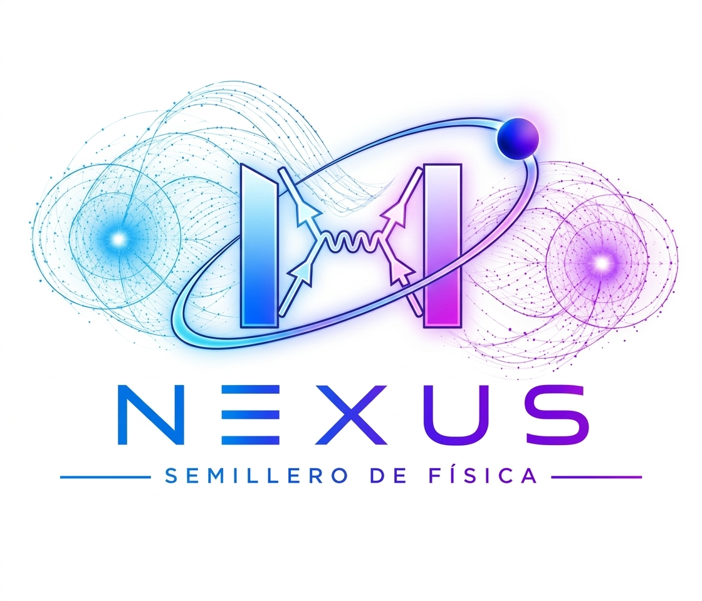
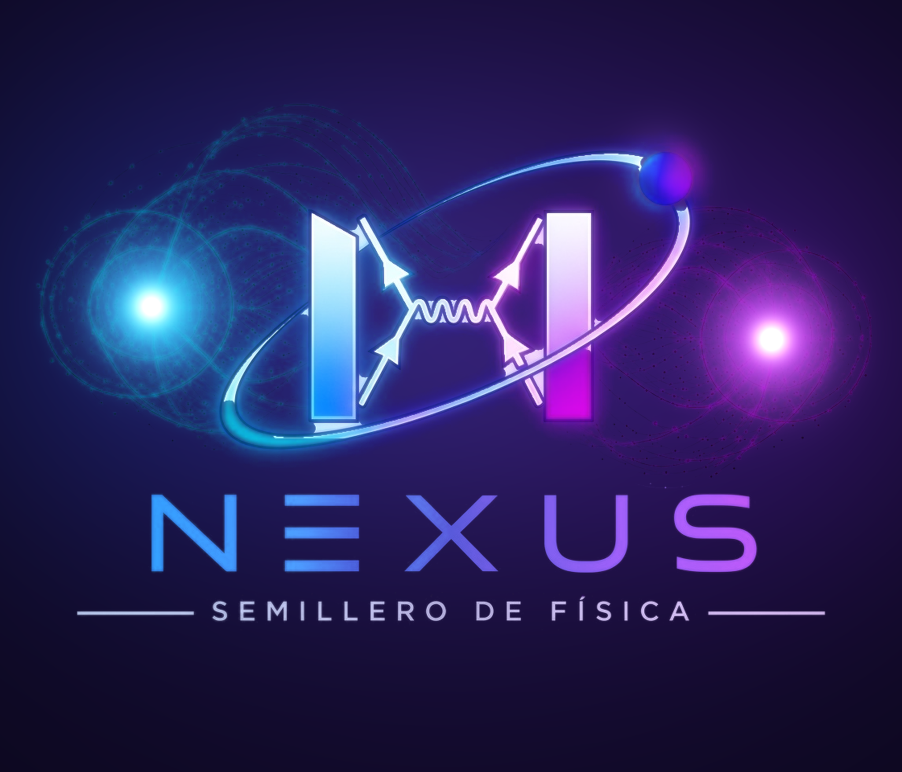
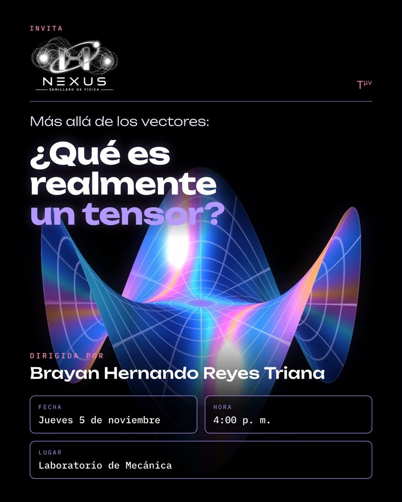
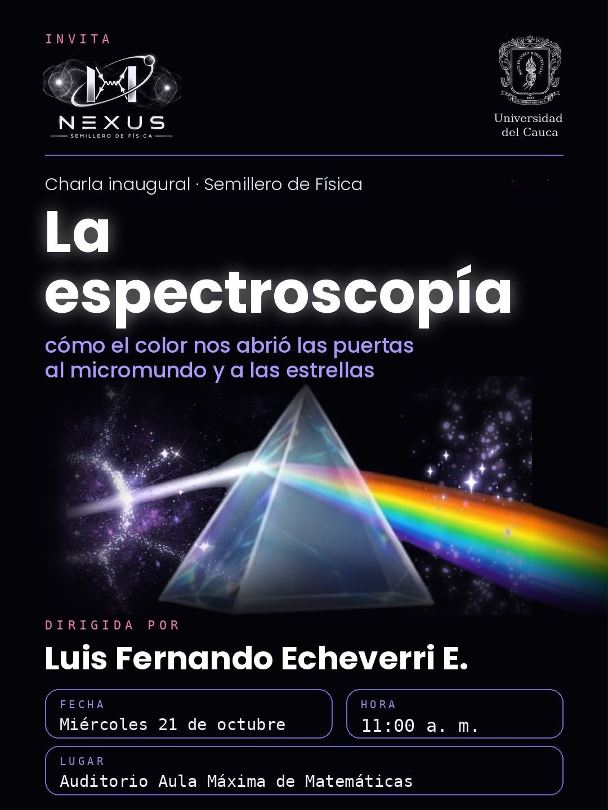
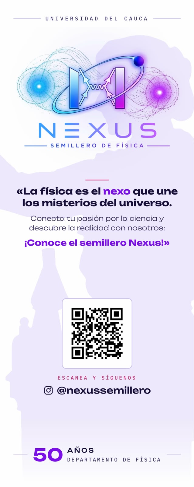
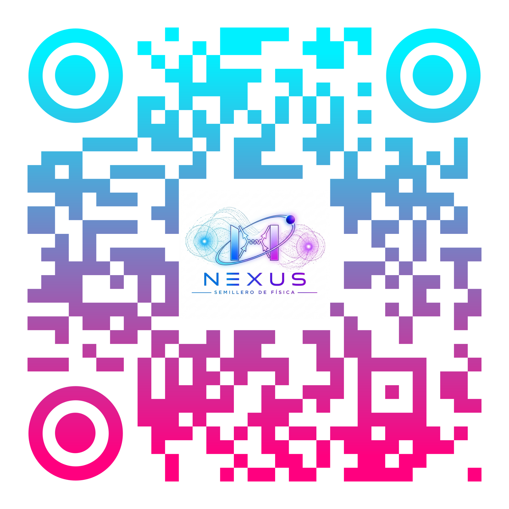

---
hide:
  - navigation
  - toc
---

  <section class="nx-hero" aria-labelledby="nx-main-title">
    

       UNIVERSIDAD DEL CAUCA · INGENIERÍA FÍSICA
      <h1 id="nx-main-title">NEXUS</h1>
      
Conectamos ideas. Expandimos la física.

      
Un semillero de <strong>física teórica</strong> donde la curiosidad se convierte en investigación, el aprendizaje se comparte y la ciencia encuentra nuevas formas de llegar a todos.

      

        <a class="nx-btn nx-btn--bright" href="#divisiones">Explora nuestras divisiones ↗</a>
        <a class="nx-btn nx-btn--ghost" href="nuestros-eventos/">Conoce nuestros eventos →</a>
      

      

        
<strong>04</strong>Divisiones

        
<strong>2026</strong>Inicio del plan

        
<strong>Popayán</strong>Colombia

      

    

    

      

      

      
      
      
 Ciencia que conecta

    

  </section>

  <section class="nx-intro nx-section" aria-labelledby="nx-intro-title">
    

      UN MISMO PROPÓSITO
      <h2 id="nx-intro-title">Más que estudiar física, <em>construimos comunidad.</em></h2>
    

    

      
En Nexus conectamos la <strong>formación académica</strong>, la <strong>investigación</strong>, la <strong>comunicación científica</strong> y la <strong>apropiación social del conocimiento</strong>.

      
Promovemos la discusión rigurosa, la lectura crítica y el aprendizaje colaborativo entre estudiantes de diferentes intereses y niveles de formación.

      <a class="nx-text-link" href="sobre-nexus/">Descubre quiénes somos ↗</a>
    

  </section>

  <section class="nx-section" id="divisiones" aria-labelledby="nx-areas-title">
    

      
LO QUE HACEMOS<h2 id="nx-areas-title">Cuatro divisiones. <em>Una misma curiosidad.</em></h2>

      
Encuentra el área que más te interese y descubre cómo se articula con las demás.

    

    

      <a class="nx-area nx-area--one" href="investigacion/">
        01 / INVESTIGACIÓN
        ⚛
        <h3>Investigar para comprender.</h3>
        
Física teórica, lectura crítica, discusión científica y proyectos colaborativos.

        Explorar división <b aria-hidden="true">↗</b>
      </a>
      <a class="nx-area nx-area--two" href="documentacion/">
        02 / DOCUMENTACIÓN
        ▤
        <h3>Organizar para aprender.</h3>
        
Guías, bibliografía, relatorías y recursos de estudio que preservan el conocimiento.

        Explorar división <b aria-hidden="true">↗</b>
      </a>
      <a class="nx-area nx-area--three" href="divulgacion/">
        03 / DIVULGACIÓN
        ◎
        <h3>Compartir para inspirar.</h3>
        
Charlas, talleres y experiencias que acercan la física a diferentes públicos.

        Explorar división <b aria-hidden="true">↗</b>
      </a>
      <a class="nx-area nx-area--four" href="creacion-contenido/">
        04 / CREACIÓN DE CONTENIDO
        ✦
        <h3>Crear para comunicar.</h3>
        
Infografías, presentaciones, videos y materiales didácticos con rigor científico.

        Explorar división <b aria-hidden="true">↗</b>
      </a>
    

  </section>

  <section class="nx-section nx-events" aria-labelledby="nx-events-title">
    

      
NEXUS EN MOVIMIENTO<h2 id="nx-events-title">Nuestros eventos.</h2>

      

Flyers de nuestras charlas y actividades: una memoria visual del conocimiento que compartimos.
<a class="nx-text-link" href="nuestros-eventos/">Ver todos los eventos ↗</a>

    

    

      <a class="nx-event" href="nuestros-eventos/#que-es-realmente-un-tensor">
        
05 NOV 2026

        
CHARLA · FÍSICA MATEMÁTICA<h3>¿Qué es realmente un tensor?</h3>
Más allá de los vectores · Brayan Hernando Reyes Triana
Ver evento ↗

      </a>
      <a class="nx-event" href="nuestros-eventos/#la-espectroscopia">
        
21 OCT 2026

        
CHARLA INAUGURAL · ÓPTICA<h3>La espectroscopía</h3>
Del color al micromundo y las estrellas · Luis Fernando Echeverri E.
Ver evento ↗

      </a>
    

    
También puedes explorar las charlas de octubre y consultar los registros audiovisuales en nuestro canal de YouTube.

  </section>

  <section class="nx-section nx-community" aria-labelledby="nx-community-title">
    

      
SEGUIMOS CONECTADOS<h2 id="nx-community-title">Aprende, participa y <em>vuelve a cada charla.</em></h2>

      
Encuentra las grabaciones, conoce los enlaces del semillero o inscríbete para formar parte de Nexus.

    

    

      <article class="nx-community__card nx-community__card--video">
        
▶

        <h3>Charlas en YouTube</h3>
        
Visita nuestro canal para consultar los registros audiovisuales de las actividades.

        <a href="charlas-grabadas/" class="nx-text-link">Conocer la videoteca ↗</a>
      </article>
      <article class="nx-community__card nx-community__card--join">
        
✧

        <h3>¿Quieres hacer parte de Nexus?</h3>
        
Únete a una comunidad que aprende, investiga y comparte física.

        <a href="participa/" class="nx-text-link">Cómo participar ↗</a>
      </article>
      <article class="nx-community__card nx-community__card--links">
        
⌁

        <h3>Nuestros enlaces</h3>
        
Encuentra los códigos y recursos para conectar con nuestras actividades.

        <a href="participa/#enlaces-del-semillero" class="nx-text-link">Ver accesos ↗</a>
      </article>
    

  </section>

    <section class="nx-section nx-conoce" id="conoce-nexus" aria-labelledby="nx-conoce-title">
    

      CONOCE NUESTRO SEMILLERO
      <h2 id="nx-conoce-title">La física es el <em>nexo</em> que nos une.</h2>
      
Conecta tu pasión por la ciencia con una comunidad dedicada a aprender, investigar y compartir conocimiento desde la Universidad del Cauca.

      
En Nexus encuentras espacios de formación, charlas y proyectos para seguir explorando las preguntas que nos inspira la física.

      

        <a class="nx-btn nx-btn--bright" href="sobre-nexus/">Conoce el semillero ↗</a>
        <a class="nx-btn nx-btn--ghost" href="participa/">Cómo participar →</a>
      

      <small>El afiche conserva su código QR original. Puedes ampliar la imagen para verlo completo.</small>
    

    <a class="nx-conoce__poster nx-poster-trigger" href="assets/img/comunidad/afiche-presentacion-nexus.jpg" aria-label="Ampliar afiche de presentación de Nexus sin salir de la página">
      
      Ampliar afiche ⤢
    </a>
  </section>

  <section class="nx-bottom" aria-labelledby="nx-bottom-title">
    

      SIGUE EXPLORANDO
      <h2 id="nx-bottom-title">Conecta con <em>Nexus</em> también desde Linktree.</h2>
      
Al final de esta página encontrarás el código QR de nuestros enlaces para acceder rápidamente a recursos, contenidos y espacios digitales del semillero.

      <a class="nx-btn nx-btn--bright" href="participa/#enlaces-del-semillero">Ver más accesos ↗</a>
      

        

          QR DE LINKTREE
          <h3>Escanéalo desde tu celular</h3>
          
Escanea el código con tu celular o abre directamente nuestros enlaces desde el botón.

          <a class="nx-linktree-direct" href="https://linktr.ee/SemilleroNexus" target="_blank" rel="noopener noreferrer">Abrir Linktree ↗</a>
        

        
      

    

  </section>

  <!-- Visor accesible, sin abrir otra pestaña. Esc, X o clic fuera para cerrar. -->
  <dialog class="nx-lightbox" id="nx-afiche-visor" aria-label="Afiche de presentación de Nexus ampliado">
    

      Presentación de NEXUS
      

        <button type="button" class="nx-lightbox__zoom" aria-label="Ampliar para leer el afiche">Ampliar +</button>
        <button type="button" class="nx-lightbox__close" aria-label="Cerrar afiche">Cerrar ✕</button>
      

    

    

      
    

    
Pulsa fuera del afiche o la tecla Esc para cerrar. Usa «Ampliar» si deseas leer los detalles.

  </dialog>

