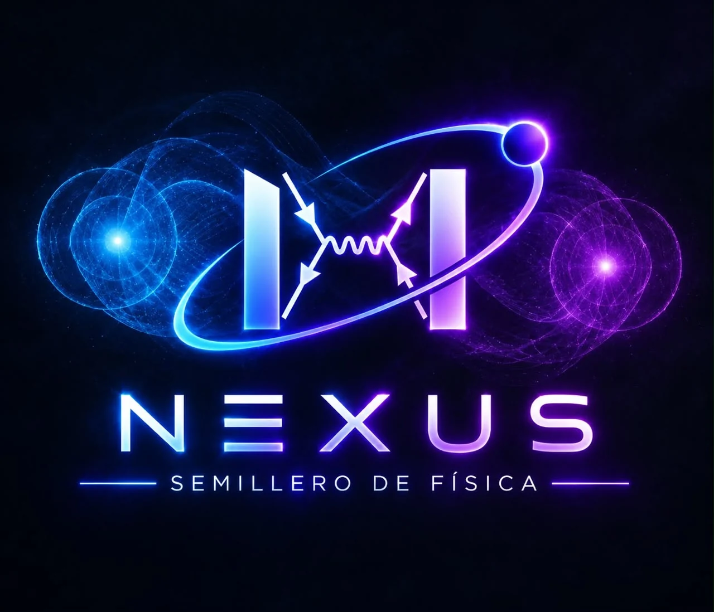
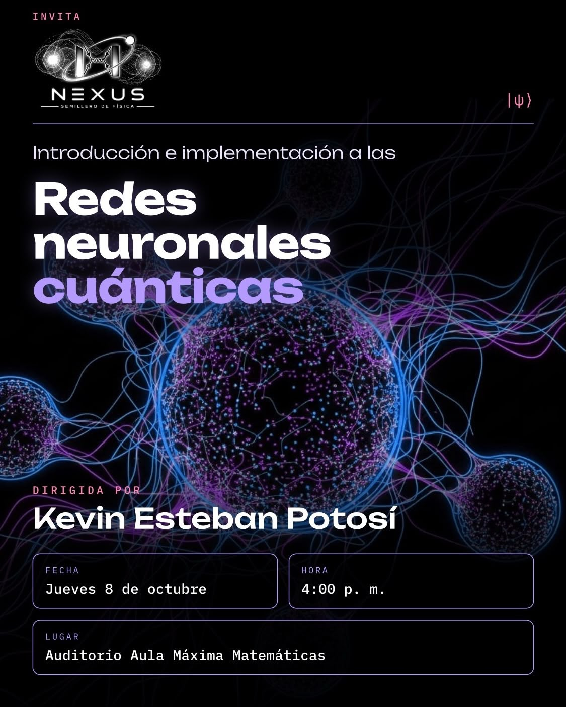
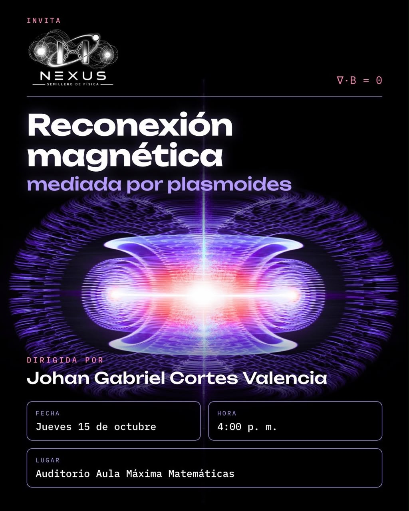

---
hide:
  - navigation
  - toc
---

  <section class="nx-hero" aria-labelledby="nx-main-title">
    

       UNIVERSIDAD DEL CAUCA · INGENIERÍA FÍSICA
      <h1 id="nx-main-title">NEXUS.</h1>
      
Conectamos ideas. Expandimos la física.

      
Un semillero de <strong>física teórica</strong> donde la curiosidad se convierte en investigación, el aprendizaje se comparte y la ciencia encuentra nuevas formas de llegar a todos.

      

        <a class="nx-btn nx-btn--bright" href="#divisiones">Explora nuestras divisiones ↗</a>
        <a class="nx-btn nx-btn--ghost" href="nuestros-eventos/">Conoce nuestros eventos →</a>
      

      

        
<strong>04</strong>Divisiones

        
<strong>2026</strong>Inicio del plan

        
<strong>Popayán</strong>Colombia

      

    

    

      

      

      
      
 Ciencia que conecta

    

  </section>

  <section class="nx-intro nx-section" aria-labelledby="nx-intro-title">
    

      UN MISMO PROPÓSITO
      <h2 id="nx-intro-title">Más que estudiar física, <em>construimos comunidad.</em></h2>
    

    

      
En Nexus conectamos la <strong>formación académica</strong>, la <strong>investigación</strong>, la <strong>comunicación científica</strong> y la <strong>apropiación social del conocimiento</strong>.

      
Promovemos la discusión rigurosa, la lectura crítica y el aprendizaje colaborativo entre estudiantes de diferentes intereses y niveles de formación.

      <a class="nx-text-link" href="sobre-nexus/">Descubre quiénes somos ↗</a>
    

  </section>

  <section class="nx-section" id="divisiones" aria-labelledby="nx-areas-title">
    

      
LO QUE HACEMOS<h2 id="nx-areas-title">Cuatro divisiones. <em>Una misma curiosidad.</em></h2>

      
Encuentra el área que más te interese y descubre cómo se articula con las demás.

    

    

      <a class="nx-area nx-area--one" href="investigacion/">
        01 / INVESTIGACIÓN
        ⚛
        <h3>Investigar para comprender.</h3>
        
Física teórica, lectura crítica, discusión científica y proyectos colaborativos.

        Explorar división <b aria-hidden="true">↗</b>
      </a>
      <a class="nx-area nx-area--two" href="documentacion/">
        02 / DOCUMENTACIÓN
        ▤
        <h3>Organizar para aprender.</h3>
        
Guías, bibliografía, relatorías y recursos de estudio que preservan el conocimiento.

        Explorar división <b aria-hidden="true">↗</b>
      </a>
      <a class="nx-area nx-area--three" href="divulgacion/">
        03 / DIVULGACIÓN
        ◎
        <h3>Compartir para inspirar.</h3>
        
Charlas, talleres y experiencias que acercan la física a diferentes públicos.

        Explorar división <b aria-hidden="true">↗</b>
      </a>
      <a class="nx-area nx-area--four" href="creacion-contenido/">
        04 / CREACIÓN DE CONTENIDO
        ✦
        <h3>Crear para comunicar.</h3>
        
Infografías, presentaciones, videos y materiales didácticos con rigor científico.

        Explorar división <b aria-hidden="true">↗</b>
      </a>
    

  </section>

  <section class="nx-section nx-events" aria-labelledby="nx-events-title">
    

      
NEXUS EN MOVIMIENTO<h2 id="nx-events-title">Nuestros eventos.</h2>

      

Conversaciones, conferencias y experiencias para compartir ciencia. Conoce nuestras actividades y su archivo visual.
<a class="nx-text-link" href="nuestros-eventos/">Ver todos los eventos ↗</a>

    

    

      <a class="nx-event" href="nuestros-eventos/#redes-neuronales-cuanticas">
        
08 OCT 2026

        
CHARLA · FÍSICA CUÁNTICA<h3>Redes neuronales cuánticas</h3>
Introducción e implementación · Kevin Esteban Potosí
Ver evento ↗

      </a>
      <a class="nx-event" href="nuestros-eventos/#reconexion-magnetica-mediada-por-plasmoides">
        
15 OCT 2026

        
CHARLA · FÍSICA DE PLASMAS<h3>Reconexión magnética mediada por plasmoides</h3>
Presentación · Johan Gabriel Cortes Valencia
Ver evento ↗

      </a>
    

    
Los flyers se conservan como archivo de las convocatorias publicadas por el semillero.

  </section>

  <section class="nx-bottom" aria-labelledby="nx-bottom-title">
    

      HACIA EL FUTURO
      <h2 id="nx-bottom-title">La física se construye <em>entre todos.</em></h2>
      
Desde el Programa de Ingeniería Física de la Universidad del Cauca, Nexus impulsa una cultura de curiosidad científica, colaboración y divulgación.

      <a class="nx-btn nx-btn--bright" href="plan-de-trabajo/">Conoce nuestro plan 2026–2027 ↗</a>
    

    
NX

  </section>

