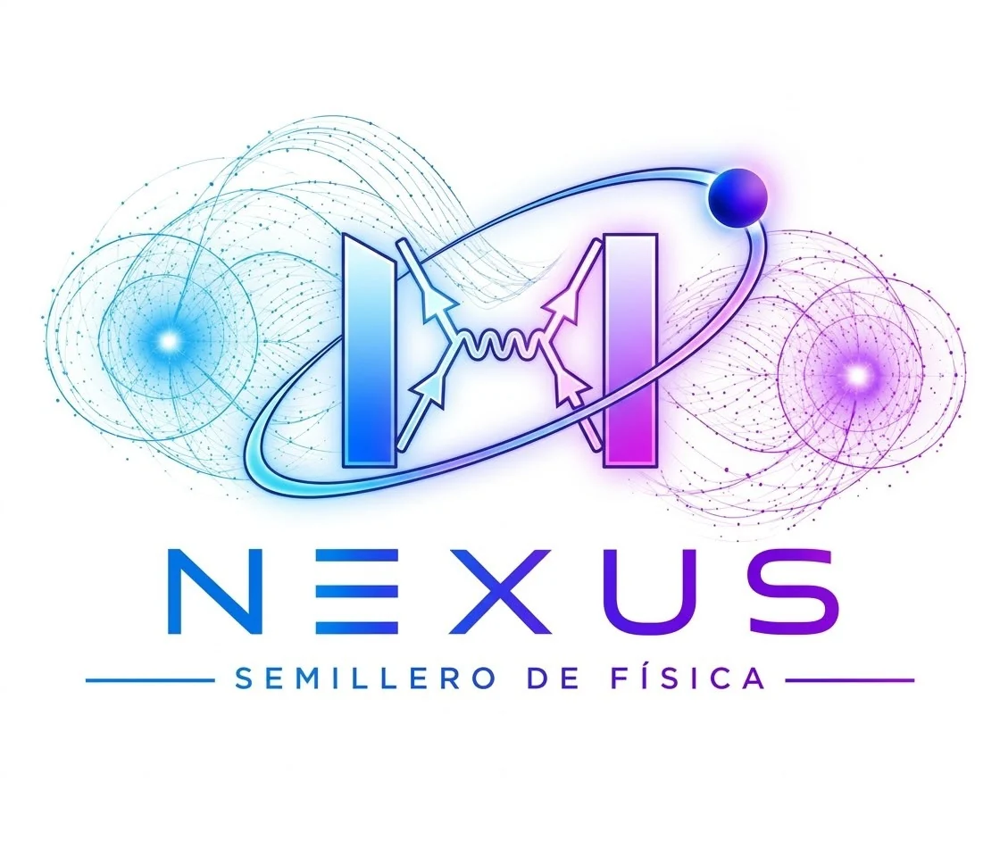

# Sobre Nexus

{ width="460" }

**Nexus — Semillero de Física Teórica** es una propuesta académica del **Programa de Ingeniería Física de la Universidad del Cauca**, en Popayán, Colombia.

## ¿Por qué «Nexus»?

El nombre representa la articulación entre formación académica, investigación, comunicación científica, enseñanza y apropiación social del conocimiento. También expresa la intención de conectar estudiantes de diferentes programas y semestres, áreas de la física y espacios académicos y educativos.

## Misión

Promover un espacio interdisciplinario de formación para la investigación, aprendizaje colaborativo, discusión científica y divulgación de la física, en el que estudiantes puedan explorar y profundizar áreas de su interés, fortalecer la lectura crítica, la búsqueda de información, la comunicación y la producción de contenidos, así como participar en actividades de enseñanza y apropiación social del conocimiento.

*Síntesis para la web de la misión del documento institucional de descripción.*

## Visión

Consolidarse como una comunidad estudiantil activa, interdisciplinaria y participativa, reconocida por su contribución a la formación para la investigación, el aprendizaje colaborativo y la comunicación científica. Se propone fortalecer vínculos con docentes, egresados, investigadores e instituciones educativas, y contribuir a que la física sea más accesible para diferentes públicos.

*Síntesis para la web de la visión del documento institucional de descripción.*

## Objetivo general

Consolidar un espacio académico de formación para la investigación en física teórica que articule aprendizaje colaborativo, producción y sistematización de contenidos, comunicación científica, enseñanza y apropiación social del conocimiento.

## Áreas temáticas de interés

- Física de la materia condensada.
- Mecánica cuántica y fundamentos de la física cuántica.
- Computación e información cuántica.
- Física matemática y aplicada.
- Física de partículas y campos.
- Relatividad y gravitación.
- Materia y sistemas de muchos cuerpos.
- Física acústica y fenómenos ondulatorios.

Estas son **áreas temáticas iniciales**, no proyectos activos confirmados. Podrán convertirse progresivamente en grupos o líneas de trabajo.

## Organización

El portal se estructura en cuatro divisiones operativas: **Investigación**, **Documentación**, **Divulgación** y **Creación de contenido**. Son una organización editorial y de trabajo del sitio; los documentos institucionales definen los objetivos formativos y científicos del semillero.
